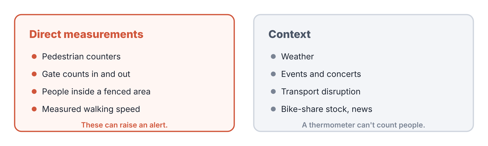
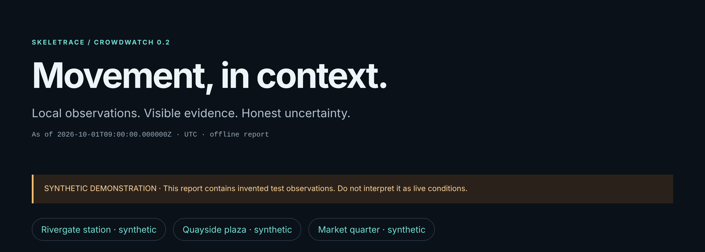
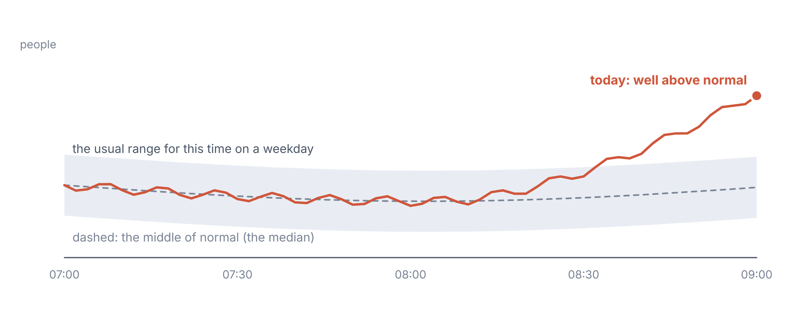
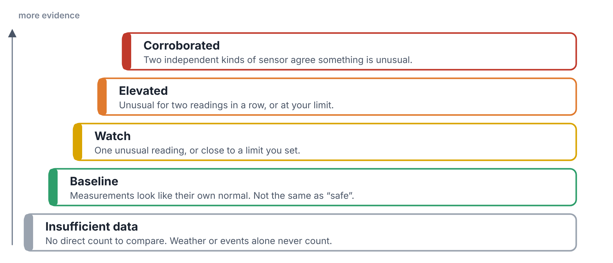
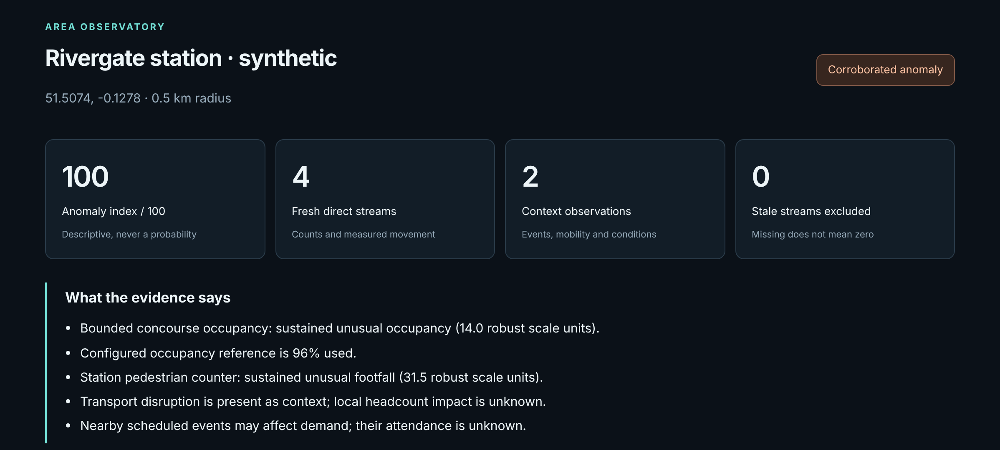
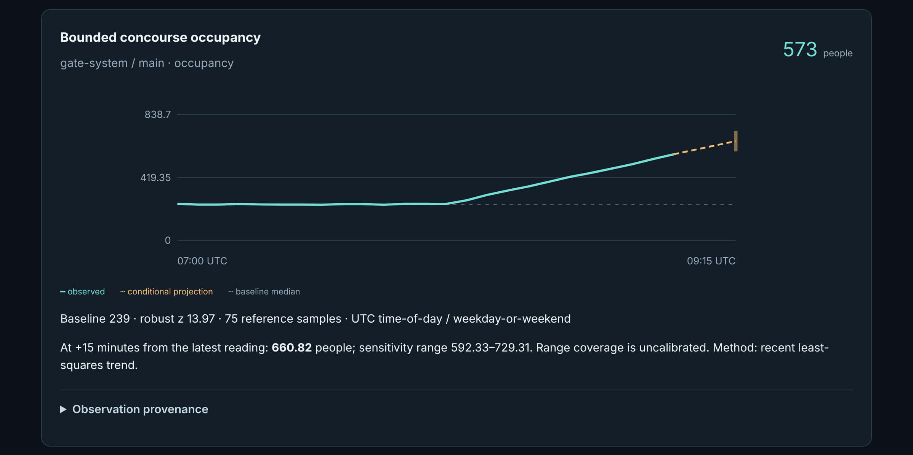
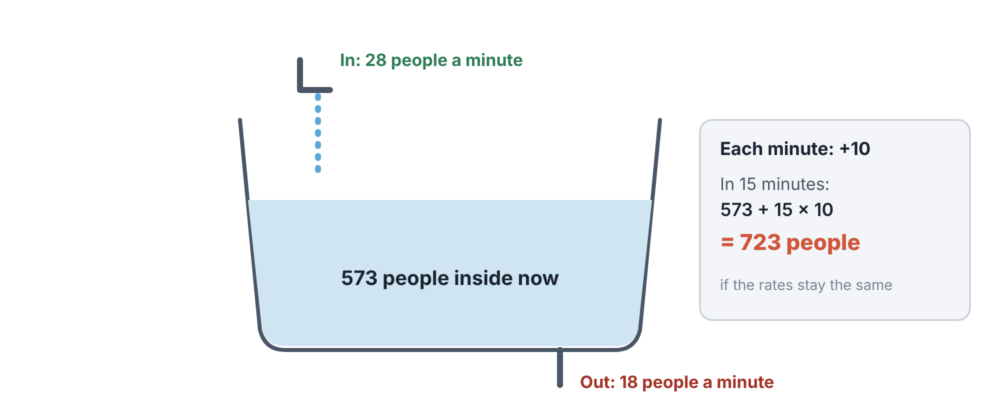
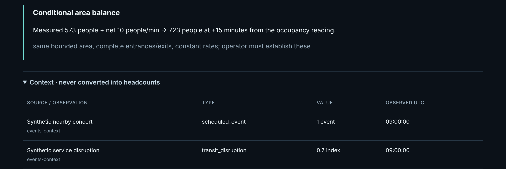
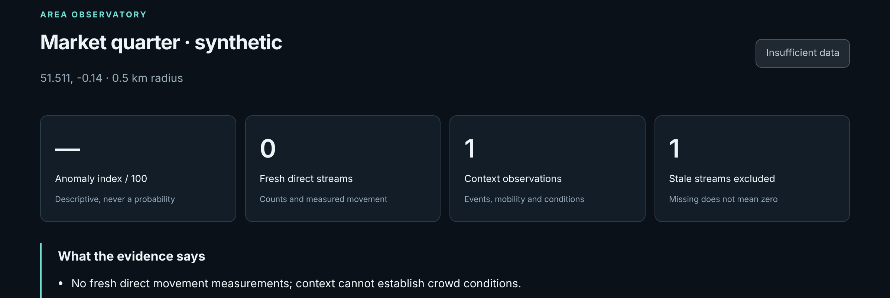

# CrowdWatch

*Know what a normal Tuesday morning looks like for a place, then notice, honestly, when today isn’t one.*

CrowdWatch 0.2.0 · a quickstart guide from whispr.dev

A shopkeeper who has stood behind the same counter for years knows what a normal Tuesday morning feels like. When the street outside is twice as busy as usual, they notice straight away, long before they could tell you why. CrowdWatch builds that same sense of “normal” for a station, a square or a market, from public counts of people passing by. Then it tells you, plainly and honestly, when today looks unusual, and what the evidence for that actually is.

## What it does, in one minute

Many cities publish live counts from sensors that count people walking past a point. Stations count people through the gates. CrowdWatch collects those counts, keeps a careful note of where and when each one came from, and compares each new reading with what’s normal for that place at that time of day.

It also collects **context**: weather, transport disruption, concerts and other events. Context can help explain a busy day, but CrowdWatch never pretends it can count people.

<figure>

<figcaption aria-hidden="true">The two kinds of data. Only direct measurements can raise an alert. Context helps you understand it.</figcaption>
</figure>

At the end, it writes a report you open in your browser. It works offline, and shows every number with the evidence behind it.

> **Words you'll meet**
>
> **Footfall:** how many people walked past a counter during a set time, such as five minutes.
>
> **Occupancy:** how many people are inside a closed area right now, such as a station concourse.
>
> **Baseline:** what’s normal for this place at this time of day, worked out from earlier days.
>
> **Unusual:** a reading far outside the baseline. CrowdWatch measures “far” in steps of normal wobble, explained below.
>
> **Context:** information about conditions (weather, events, disruption) that can’t count people.
>
> **Projection:** a short look ahead, at most 30 minutes, if things carry on as they are.

## Get it on your computer

CrowdWatch is free. Download it from the **Releases** page of github.com/whisprer-specops/crowdwatch, or from skeletrace.com/works-with.

| Your computer             | Download                              | Then                                                                                                                                               |
|---------------------------|---------------------------------------|----------------------------------------------------------------------------------------------------------------------------------------------------|
| Windows 10 or 11          | `crowdwatch-windows-x86_64-setup.exe` | Double-click it. Windows may say “Windows protected your PC”, because the program isn’t code-signed yet. Click **More info**, then **Run anyway**. |
| Mac (Apple chip or Intel) | `crowdwatch-macos-universal.run`      | Open Terminal and type `sh ~/Downloads/crowdwatch-macos-universal.run`                                                                             |
| Linux (most PCs)          | `crowdwatch-linux-x86_64.run`         | Open a terminal and type `sh ~/Downloads/crowdwatch-linux-x86_64.run`                                                                              |
| Linux on ARM              | `crowdwatch-linux-aarch64.run`        | As above, with that file name                                                                                                                      |

The installer shows the licence and asks you to accept it (on a Mac or Linux, press Space to page through, then type `y`). It then suggests a folder: on Windows `%LOCALAPPDATA%\Programs\CrowdWatch`, on a Mac `~/Applications/CrowdWatch`, and on Linux `~/CrowdWatch`. Press Enter to accept. Nothing else changes; to remove CrowdWatch, delete the folder.

## Your first five minutes: the demo

The demo invents three places and an hour or two of readings, then builds a full report. It needs no internet, no accounts and no keys.

1.  Open a terminal and go to the program’s folder. On Windows:

    ``` powershell
    cd "$env:LOCALAPPDATA\Programs\CrowdWatch"
    ```

    On a Mac, type `cd ~/Applications/CrowdWatch`; on Linux, `cd ~/CrowdWatch`. Then use `./crowdwatch` wherever this guide says `.\crowdwatch.exe`.

2.  Make the demo. The `--at` part fixes the clock, so you get exactly the report shown in this guide:

    ``` powershell
    .\crowdwatch.exe demo --out my-demo --at 2026-10-01T09:00:00Z
    ```

3.  Open the report:

    ``` powershell
    Invoke-Item my-demo\report.html
    ```

    On a Mac, type `open my-demo/report.html`; on Linux, `xdg-open my-demo/report.html`.

The demo tells three short stories, one for each invented place:

| Place             | What’s happening                        | What CrowdWatch says                                         |
|-------------------|-----------------------------------------|--------------------------------------------------------------|
| Rivergate station | A crowd building up through the morning | **Corroborated anomaly**: two separate kinds of sensor agree |
| Quayside plaza    | An ordinary morning                     | **Within observed baseline**                                 |
| Market quarter    | The people counter has broken           | **Insufficient data**: it refuses to guess                   |

<figure>

<figcaption aria-hidden="true">The top of the demo report. The orange banner reminds you the data is invented. Each place has its own section below.</figcaption>
</figure>

## How CrowdWatch decides what’s unusual

### Step 1: learn the baseline

For each counter, CrowdWatch looks back at earlier days, at about the same time of day (within half an hour either side), and on the same kind of day: weekday or weekend. The middle of those readings is the baseline. It also measures how much the readings usually **wobble** around that middle.

<figure>

<figcaption aria-hidden="true">The grey band is the usual range for this time of morning. Today’s line climbs well above it.</figcaption>
</figure>

### Step 2: measure how far today is from normal

A reading is compared with the baseline in steps of normal wobble. If a station usually sees 30 people in five minutes, give or take a few, then 124 people is a very long way out: in the demo, more than 30 steps. CrowdWatch calls a reading **unusual** once it’s 3 or more steps above normal.

> **Think of it like this**
>
> Think of a family’s weekly shop. It usually comes to about £80, give or take £10. A £90 shop isn’t worth a second thought. A £200 shop is ten “give or takes” out, and somebody will want to know what happened.

### Step 3: check it isn’t a one-off

A single odd reading could be a glitch. If the last **two readings in a row** are unusual, CrowdWatch calls it **sustained**. And if two **independent** kinds of sensor both show something sustained, such as the people counter and the gate counts, it calls it **corroborated**.

<figure>

<figcaption aria-hidden="true">The five evidence levels, from the bottom up. Each step needs more evidence than the one below.</figcaption>
</figure>

> **Heads-up**
>
> “Baseline” means “looks like its own normal”. It doesn’t mean “safe”. CrowdWatch only describes the measurements it has. It never says whether a crowd is dangerous.

## Reading the report

Each place has its own section. At the top are four numbers and a summary of the evidence, in plain sentences.

<figure>

<figcaption aria-hidden="true">Rivergate station. The anomaly index is 100 out of 100, from four fresh streams of measurements, with two pieces of context. The evidence is listed underneath.</figcaption>
</figure>

The **anomaly index** runs from 0 to 100. It’s based on the single most unusual reading in that place, and reaches 100 at 6 steps from normal. It’s a description, not a percentage chance of anything.

Below that, each stream of measurements gets a chart.

<figure>

<figcaption aria-hidden="true">Occupancy of the station concourse. The solid line is what was measured; the dashed grey line is the baseline; the orange dashes on the right are a short projection, with its range shown as the bar at the end.</figcaption>
</figure>

The text under each chart gives the baseline, how many steps out the latest reading is, and the **projection**: where the line is heading over the next few minutes if it carries on the same way. The range around a projection shows how much it could vary. It isn’t a guarantee, and the report says so.

### The bathtub sum

Where a place counts people **in**, **out** and **inside**, CrowdWatch can do one more calculation. It’s the same sum as filling a bath with the plug out.

<figure>

<figcaption aria-hidden="true">The area balance. 573 people inside, 28 a minute coming in, 18 a minute going out: 10 more each minute, so 723 in 15 minutes, if nothing changes.</figcaption>
</figure>

<figure>

<figcaption aria-hidden="true">The same sum in the report, and the context underneath it. A concert and a service disruption are listed, but never turned into a headcount.</figcaption>
</figure>

### When the evidence runs out

The market quarter’s counter has failed. Rather than fill the gap with a guess, or treat “no reading” as zero, CrowdWatch says so.

<figure>

<figcaption aria-hidden="true">Market quarter. No fresh direct measurements, so the status is “Insufficient data”. The weather reading alone can’t establish anything about crowds.</figcaption>
</figure>

At the end of the report, **Collection health** shows each source’s latest state, so you can see a broken feed at a glance.

## Use real public data

CrowdWatch comes with three ready-made setups, called **presets**. Melbourne’s is the best place to start: the city publishes live counts from real pedestrian sensors.

1.  Write a Melbourne configuration file:

    ``` powershell
    .\crowdwatch.exe init --preset melbourne --out melbourne\config.json
    ```

2.  Collect the latest readings:

    ``` powershell
    .\crowdwatch.exe collect --config melbourne\config.json
    ```

3.  Make the report and open it:

    ``` powershell
    .\crowdwatch.exe report --config melbourne\config.json --out melbourne\report.html
    Invoke-Item melbourne\report.html
    ```

> **Heads-up**
>
> A brand-new setup has no history yet, so at first everything says “Insufficient data”, or that the baseline is still warming up. That’s honest, not broken. Keep collecting, over days, and the baselines fill in.

The other presets are `london`, which starts with weather and has Transport for London and Ticketmaster sources ready to switch on once you add keys, and `new-york`, which adds Citi Bike stock. Bike stock tells you about transport, not about how many people are walking past.

To watch a place for yourself, change the region’s name, latitude, longitude and radius in `config.json`, then add your own local counts. The full guide on GitHub covers all nine kinds of collector, with examples.

## Keep it running

To collect and report automatically, leave this running in its own terminal window:

``` powershell
.\crowdwatch.exe watch --config melbourne\config.json --out melbourne\monitor
```

It checks every minute. Each source has its own schedule, and a failed source never stops the others. Refresh `melbourne\monitor\report.html` in your browser to see the latest report. Press `Ctrl+C` to stop.

## Other useful commands

| Command                                                     | What it does                                                                                            |
|-------------------------------------------------------------|---------------------------------------------------------------------------------------------------------|
| `doctor --config FILE`                                      | Checks your setup: the database, which sources are switched on, and how each one’s last collection went |
| `analyse --config FILE --out analysis.json`                 | The full analysis as JSON, without the web page                                                         |
| `backtest --config FILE --horizon 15 --out evaluation.json` | Replays history, to test how good the 15-minute projections really were                                 |
| `import --config FILE DATA.json`                            | Brings in counts from a file                                                                            |
| `prune --config FILE --keep-days 35`                        | Deletes readings older than 35 days                                                                     |
| `export-skeletrace --config FILE --out FOLDER`              | Writes the data in a form SkeleTrace reads                                                              |

Add `--at` and a date and time to `analyse`, `report`, `backtest` or `export-skeletrace` to see the picture **as it was** at that moment, using only the readings that had arrived by then.

## What it can and can’t tell you

> **What it can't tell you**
>
> **Counters count passings, not people.** One person walking past twice counts twice. Two counters on the same street may both see the same people, so CrowdWatch never adds them together.
>
> **Context can’t count.** Rain, a concert or a train strike may explain a busy day, but CrowdWatch never turns them into a number of people.
>
> **Projections are short and hedged.** At most 30 minutes ahead, and only if there are enough recent, regular readings. The range shown is a guide, not a promise.
>
> **It doesn’t predict danger.** There’s no built-in “safe” number of people. Any limit, such as an area’s capacity, is one you set, and it’s only as good as your knowledge of that place.
>
> **It never tracks individuals.** It works only with totals, such as counts and occupancy figures. No phones, faces or personal data.

## Cheat sheet

| To do this           | Type this (Windows; use `./crowdwatch` on Mac and Linux)                   |
|----------------------|----------------------------------------------------------------------------|
| Try the demo         | `.\crowdwatch.exe demo --out my-demo`                                      |
| Set up Melbourne     | `.\crowdwatch.exe init --preset melbourne --out melbourne\config.json`     |
| Collect readings now | `.\crowdwatch.exe collect --config melbourne\config.json`                  |
| Make a report        | `.\crowdwatch.exe report --config melbourne\config.json --out report.html` |
| Keep collecting      | `.\crowdwatch.exe watch --config melbourne\config.json --out monitor`      |
| Check your setup     | `.\crowdwatch.exe doctor --config melbourne\config.json`                   |
| See the past         | add `--at 2026-10-01T09:00:00Z` to `report`                                |
| See every option     | `.\crowdwatch.exe --help`                                                  |


## Where to go next

The full guide is on GitHub at github.com/whisprer-specops/crowdwatch, with the downloads under Releases. Its docs folder explains exactly what the model calculates (MODEL.md) and how to add data sources (SOURCES.md).

The whole set, each one free software under GPL-3.0-only:

- **SkeleTrace**: A detective’s pinboard that does the maths
- **Maxwell’s Demon Detector**: Network traffic as a river of racing lanes
- **OSINTropy**: An evidence locker for public records
- **CrowdWatch**: What normal looks like, and when today isn’t

All four quickstart guides are at skeletrace.com/guides.

*CrowdWatch 0.2.0. © 2026 whispr.dev. Screenshots are from the program itself; every example in them is invented.*
